

  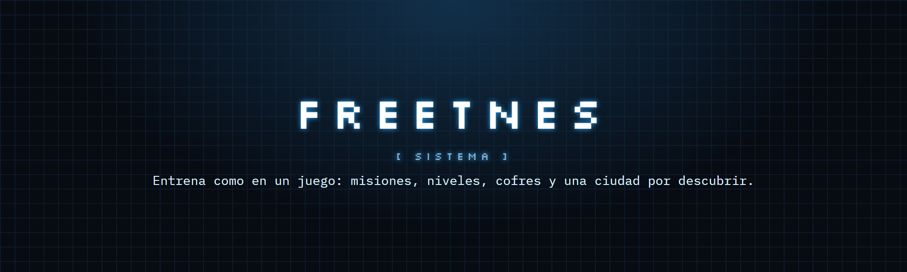

  
  
  
  
  

  <a href="https://github.com/mrkiuper/freetnes/releases/latest/download/Freetnes.apk">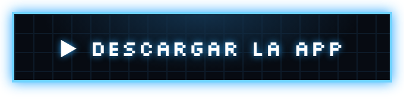</a> 
  <a href="https://github.com/mrkiuper/freetnes/releases">Ver todas las versiones</a>

**Freetnes** arma tu plan de ejercicio de la semana según tus días libres, tu horario y el equipo que tienes, y lo convierte en un juego. Cada entrenamiento es una **misión** con rango de F a S; al cumplirla ganas **XP**, subes de **nivel**, abres **cofres** y tu héroe se vuelve más fuerte. Funciona para gimnasio, casa, bici, correr y HIIT, y no necesitas crear cuenta.

  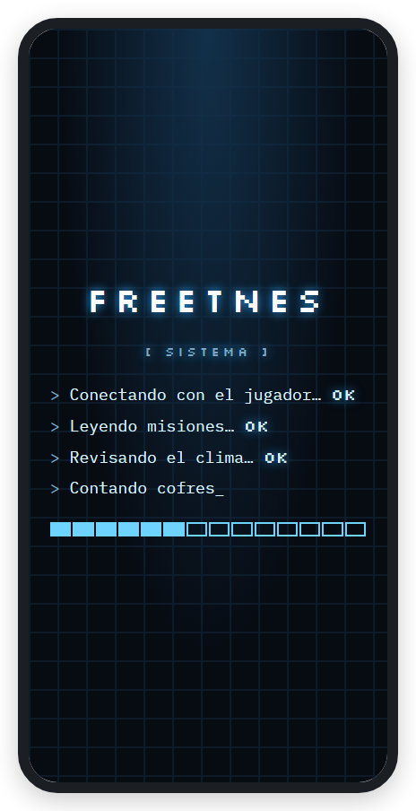
  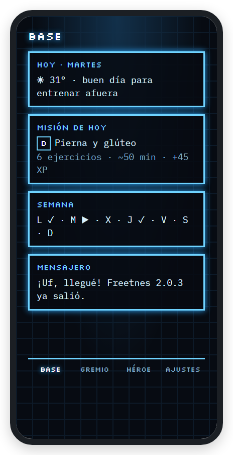
  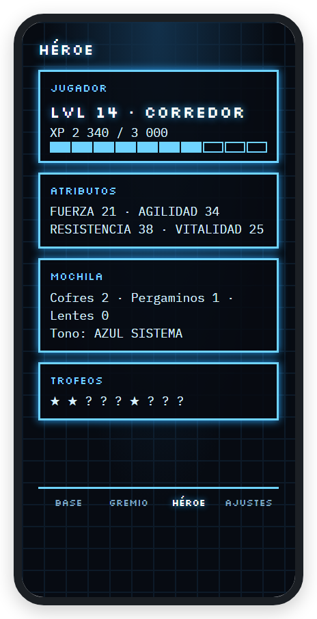
  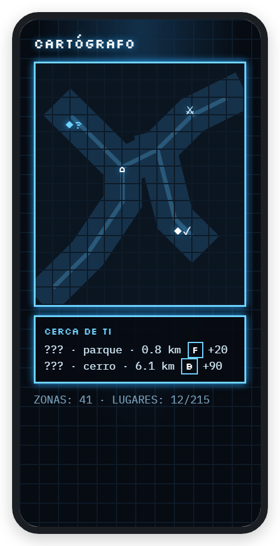

## Contenido

[Base](#-base-tu-día) · [Gremio y misiones](#-gremio-y-misiones) · [Entrenar paso a paso](#-entrenar-paso-a-paso) · [Bici, correr y HIIT](#-bici-correr-y-hiit) · [Cartógrafo](#-cartógrafo) · [Héroe y cofres](#-héroe-y-cofres) · [Progreso](#-progreso) · [Ajustes y privacidad](#-ajustes-y-privacidad) · [Instalar](#-instalar) · [Actualizar](#-actualizar) · [Preguntas](#-preguntas) · [Novedades](#-novedades-de-la-20)

## 🏠 Base: tu día

<table><tr>
<td width="230"></td>
<td>

Lo primero que ves al abrir la app: qué te toca hoy y cómo va tu semana.

- La **misión de hoy** con su rango, duración y XP.
- El **clima** de tu ciudad, para saber si conviene entrenar afuera.
- La **semana de un vistazo**: días hechos, hoy y lo que viene.
- Avisos del **Mensajero** cuando sale una versión nueva.

</td></tr></table>

## ⚔ Gremio y misiones

<table><tr>
<td>

Tu plan semanal convertido en un tablón de misiones.

- El plan se arma solo con tus **días fijos**, tu horario y tu equipo (gimnasio, casa, mancuernas…).
- Misiones de rango **F a S**, con fecha de vencimiento y días de **jefe**.
- ¿Hoy no puedes? **Cambia el día** o agrega un partido extra; el plan se reacomoda.
- **Aventura libre** para entrenar lo que quieras fuera del plan.

</td>
<td width="230">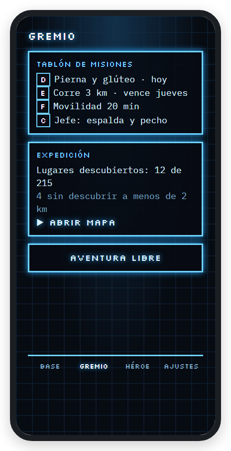</td>
</tr></table>

## 🏋 Entrenar paso a paso

<table><tr>
<td width="230">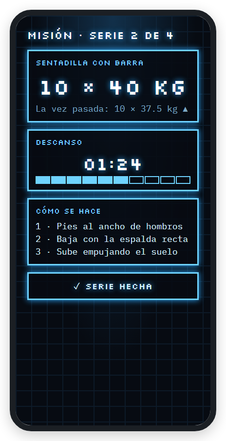</td>
<td>

La app te guía serie por serie para que no tengas que pensar.

- Repeticiones y peso **a la vista**, comparados con la vez pasada.
- **Temporizador de descanso** con sonido.
- **Cómo se hace** cada ejercicio, en 3 pasos y con dibujo.
- **Progresión automática**: sube el peso o las repeticiones cuando ya estás listo.
- **Movilidad**: calentamiento de 5 min o sesión de 20 min.

</td></tr></table>

## 🚲 Bici, correr y HIIT

<table><tr>
<td>

Para el cardio, dentro y fuera de casa.

- Graba tus rodadas y carreras con **GPS**: ruta, distancia, tiempo y velocidad.
- Lee tu **pulso** de la pulsera o reloj (con Health Connect).
- Entrenamientos **HIIT, EMOM y AMRAP** guiados con temporizador.
- Cada actividad suma XP y cuenta para tu clase.

</td>
<td width="230">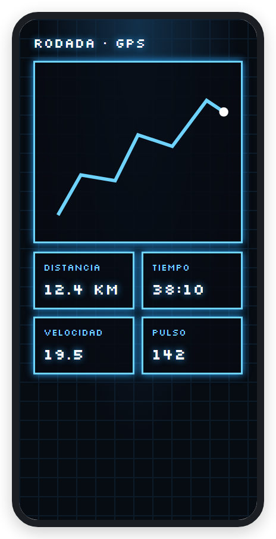</td>
</tr></table>

## 🗺 Cartógrafo

<table><tr>
<td width="230"></td>
<td>

Tu ciudad es un mapa cubierto de niebla. Sal a moverte para descubrirla.

- Cada zona que recorres **se despeja** del mapa.
- **215 lugares de Culiacán** por descubrir: parques, cerros, estadios, museos…
- Entre más lejos de tu base, **más XP**; los cerros valen un rango extra.
- **Te avisa al llegar** a un lugar nuevo, aunque la app esté cerrada.
- El mapa viene dentro de la app: **funciona sin internet**.

</td></tr></table>

## 🛡 Héroe y cofres

<table><tr>
<td>

Tu progreso convertido en un personaje que crece contigo.

- **Niveles y XP** por cada misión cumplida.
- **6 clases** de aventurero según cómo entrenas: Corredor, Asesino, Guerrero, Tanque, Monje y Explorador.
- **Atributos** que se calculan con tus entrenamientos reales.
- **Cofres** al terminar: tonos de color para la app, pergaminos y la ultrarrara **Lente de la verdad**.
- **Trofeos ocultos** y un **códice** de ejercicios que se desbloquea con tu nivel.

</td>
<td width="230">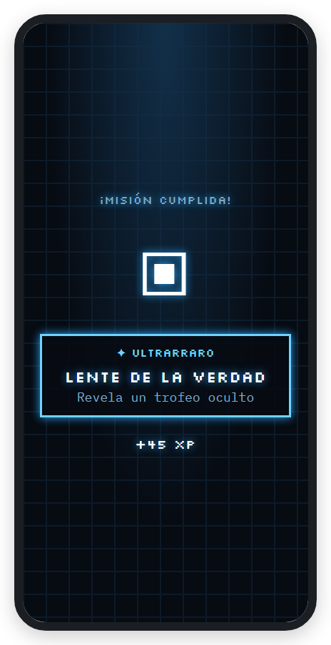</td>
</tr></table>

## 📈 Progreso

<table><tr>
<td width="230">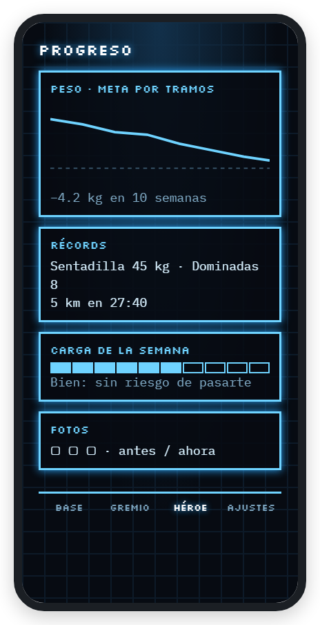</td>
<td>

Para ver que de verdad estás avanzando.

- **Peso** con meta por tramos y gráfica.
- **Fotos de progreso** con silueta guía y comparación antes / ahora (protegidas).
- **Récords personales** de cada ejercicio.
- **Carga de la semana**: te avisa si te estás pasando o te quedas corto.
- **Calendario** e historial de todo lo que has hecho.

</td></tr></table>

## ⚙ Ajustes y privacidad

<table><tr>
<td>

Tú decides cómo se ve y qué comparte la app.

- **PIN o huella** para abrir la app.
- **Health Connect**: pasos, pulso y sueño de tu reloj o pulsera.
- **Respaldo**: guarda una copia y pásala a otro teléfono.
- **Pausa** por vacaciones, enfermedad o lesión, y el plan se reacomoda al volver.
- Tonos de color, sonidos, recordatorios y clima.

</td>
<td width="230">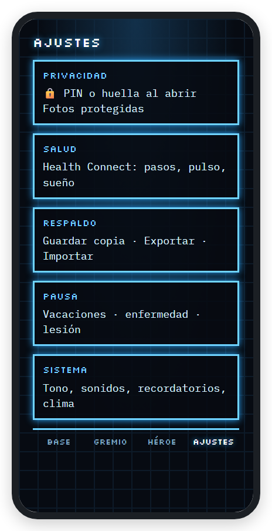</td>
</tr></table>

## 📲 Instalar

1. Desde el teléfono, toca **[Descargar la app](https://github.com/mrkiuper/freetnes/releases/latest/download/Freetnes.apk)**.
2. Abre el archivo `.apk`. Si Android pregunta, permite «instalar apps de esta fuente».
3. Toca **Instalar**. Al abrirla, la app te hace unas preguntas para armar tu plan.

## 🔄 Actualizar

Una vez al día, la app revisa si hay versión nueva y te avisa en la Base. Tocas **Descargar** y luego **Actualizar**: tu progreso no se pierde.

> [!NOTE]
> Para revisar si hay versión nueva, la app solo pregunta cuál es la última. No envía tus datos a ningún lado.

## ❓ Preguntas

| Pregunta | Respuesta |
|---|---|
| ¿Necesito crear una cuenta? | No. Todo se guarda en tu teléfono. |
| ¿Necesita internet? | No para entrenar ni para el mapa. Solo para el clima y para saber si hay versión nueva. |
| ¿Funciona en iPhone? | Por ahora solo en Android 8.0 o más nuevo. |
| ¿Pierdo mi progreso al actualizar? | No. La versión nueva se instala encima y conserva todo. |
| ¿Por qué pide la ubicación «todo el tiempo»? | Solo si enciendes «Avisarme al llegar» en el Cartógrafo. Es opcional y se apaga ahí mismo. |
| ¿Cuesta algo? | Es gratis y sin anuncios. |

## ✨ Novedades de la 2.0

- Nuevo estilo **«El Sistema»**, con pestañas Base · Gremio · Héroe · Ajustes.
- **Clases de aventurero** y misiones con rango F–S.
- **Cartógrafo** con lugares de la ciudad y aviso al llegar.
- **Trofeos ocultos** y la **Lente de la verdad**.
- Nueva pantalla de carga.
